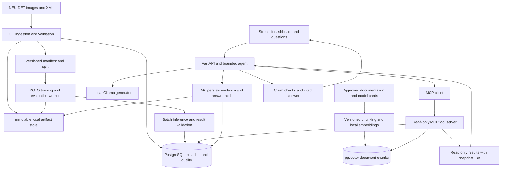

# System architecture

This is the implementation contract for a local research prototype. Decisions are proposed, not deployed. The primary research component is an evidence-grounded LLM agent; the image pipeline produces reliable data for its analysis. See [evaluation](../plan/evaluation-and-thesis.md) for how each claim will be tested.

## Components and flow

Use one Python codebase with separate processes for the API/agent, worker, MCP server and UI. These share domain contracts, not duplicate business logic. PostgreSQL stores metadata and results; a local mounted directory stores immutable images, manifests and checkpoints. pgvector adds document embeddings to the same database. Ollama serves both local generation and embedding models.



The ingestion/training path is a CLI/worker workflow, not a tool the LLM can trigger. UI charts use the same analytical service definitions as MCP. A single agent is sufficient; no multi-agent planner, plugin marketplace, autonomous scheduling or general agent framework is needed for the research questions.

## End-to-end workflow

1. **Ingest:** register archive provenance, hash source files, preserve bytes, extract metadata and import original annotations. A repeated request is safe.
2. **Validate and release:** quarantine failed assets, review warnings and labels, establish duplicate groups, freeze a versioned dataset/split manifest.
3. **Train and evaluate:** fine-tune YOLO11n using training/validation only, register config/environment/checkpoints, evaluate the frozen test set after choices are frozen.
4. **Infer:** apply an approved model to a known batch; validate output classes/boxes, invert image transforms and commit results per image. Store zero-detection successes explicitly.
5. **Aggregate:** deterministic SQL computes defined metrics from explicitly selected runs and scopes. The API captures and persists a coherent analytical snapshot before tool execution. Comparisons must use compatible definitions and thresholds.
6. **Index documents:** chunk approved content with provenance, create local embeddings, and activate an immutable corpus/index version only when complete.
7. **Answer:** the agent selects up to three bounded tools and receives read-only evidence from the pinned snapshot. The API persists the evidence bundle before generation. It produces structured claims and citations and passes them through checks. One repair attempt is allowed; otherwise return a partial answer, clarification or abstention.
8. **Audit:** save the question, model/prompt versions, tools/arguments/results, evidence hashes, original draft, checks, final answer and timings. Never store hidden reasoning as required evidence; the observable tool trace is sufficient.

## Ownership and interfaces

| Module | Receives | Produces | Owner process |
|---|---|---|---|
| Catalog and validation | Source archive/folder, dataset config | Asset metadata, quality issues, released manifest | Worker/CLI |
| Vision | Released manifest, model/preprocessing config | Model artifacts, evaluation metrics, predictions | Worker/CLI |
| Analytics | Dataset/batch/run/filter IDs | Typed metric evidence and provenance | Shared domain service |
| Retrieval | Approved docs, corpus version, query | Ranked chunks with source identifiers | Indexer and MCP server |
| Agent | User question and selected scope | Cited answer, verification status and trace | API process |
| Presentation | API responses | Charts, overlays, evidence views and exports | Streamlit |

Proposed API surface: `GET /health`, `GET /datasets`, `GET /runs/{id}`, `GET /batches/{id}/metrics`, `GET /images/{id}/results`, `GET /quality`, `POST /questions`, `GET /answers/{id}`, and `GET /evidence/{id}`. Inputs use Pydantic schemas; errors distinguish unknown IDs, unavailable data, incompatible scopes, timeout and internal failure. Long ML jobs run through CLI, not HTTP background tasks. The API delegates analytics to the same service as MCP and does not recompute formulas.

## Storage and database contract

Images and model files do not live as large database blobs. Keys are relative artifact URIs resolved inside an approved storage root, never arbitrary user file paths. Tables below are logical entities; M1 migrations can combine small metadata records where that preserves constraints.

| Entity | Essential fields and constraints |
|---|---|
| `dataset_versions` | ID, source URL/citation, archive hash, manifest hash, class-map version, status, created time; released versions immutable |
| `assets` | ID, byte SHA-256 unique, raw URI, dimensions/channels, decoded status; source aliases in manifest/catalog |
| `dataset_items` | Dataset version + asset unique, source name, group ID, split, annotation revision; composite FK targets for run membership |
| `annotations` | ID, item/revision, source XML hash, class, canonical box, author/type/reason; finite coordinates and class constraints |
| `quality_issues` | ID, version/item/batch, rule and ruleset version, severity, observed/expected, resolution audit |
| `batches` and `batch_items` | ID, dataset version, kind, membership hash; unique batch/asset membership and same-version enforcement |
| `runs` | ID, kind, status, explicit `dataset_version_id`, split/config hashes, code revision, environment artifact, seed, device, timestamps, error; inference requires `model_id` and `batch_id`, evaluation requires `model_id` and evaluation split; training/inference/evaluation distinguished |
| `models` | ID, training run, artifact URI/checksum, architecture, class map, preprocessing config; immutable |
| `image_results` | Unique inference run + asset, explicit dataset version and batch, status, prediction count, latency, attempt count; composite FKs enforce run/version/batch and batch/item membership; successful zero-detection row retained |
| `detections` | Image-result ID + ordinal unique, class, score in [0,1], original-coordinate box; predictions never written as annotations |
| `evaluation_metrics` | Evaluation run, split manifest, metric name/class, value, protocol/config hash; no ambiguous generic accuracy field |
| `corpus_versions` and `document_chunks` | Corpus hash/status, document hash/version/source, section/page, chunk hash/text, embedding model digest and vector dimension |
| `analytics_snapshots` | ID, immutable scoped metric/quality/provenance payload, hash, capture time, dataset/batch/run IDs, run-state/coverage, query version and pinned corpus ID; written by API, read by MCP |
| `evidence_bundles` | ID, immutable JSON artifact/hash, scope, query/corpus versions, created time; query snapshot persisted before generation |
| `agent_answers` | ID, question, scope, generator/prompt/tool versions, evidence IDs, trace/draft/final artifact URIs, check results, timing and status |

Use UUIDs for identity and SHA-256 for content identity. Add foreign keys, unique constraints, indexes on batch/run/class, and checks for positive sizes, finite numeric values and bounded scores. Cross-table geometry and dataset/model compatibility are validated in service code or database triggers; a PostgreSQL `CHECK` alone cannot enforce an arbitrary join. Class-map version compatibility is checked before inference. Use timezone-aware UTC timestamps; presentation can use Asia/Shanghai.

One inference run belongs to exactly one dataset version, one model and one immutable batch membership manifest. A new intentional run gets a new ID even if those inputs match. Each image result must reference both that run's version/batch tuple and an asset in `batch_items`; `batch_items` in turn references the dataset version's item. Store the corresponding composite unique keys/FKs in migrations. Shared raw asset bytes across dataset versions do not imply shared labels or prediction records. Add a fixture where one asset occurs in two versions with different annotation revisions and in two repeated runs; results and analytics must remain distinct.

The run configuration contains dependency lock hash, Git commit and dirty-state/source archive hash, model checksum, dataset and annotation revisions, preprocessing settings, seed, device, image size, thresholds and library versions. Exact reproducibility is strongest for artifacts/configuration; GPU numeric behavior may differ and must be reported.

### Atomicity and retry behavior

Write an artifact to a temporary file, verify checksum, then atomically rename before recording its URI in a committed database transaction. A failed database commit may leave an orphan file; a reconciliation command reports/removes unreferenced temporary artifacts after a safe grace period. Never delete referenced artifacts during normal runs.

Ingest key: source archive hash + importer/ruleset config hash. A retry resumes the same operation; a changed config creates a new version. Inference run identity includes model, dataset/batch and preprocessing/threshold config. Resume explicitly uses that run ID; an intentional new experiment gets a new ID. For each image, insert its completed status and detections in one transaction with the uniqueness constraint. Retry transient failures at most twice; do not retry invalid data indefinitely. Recompute only incomplete/failed items. States are `pending → running → succeeded / partial / failed`; never turn a partial run into apparent full coverage.

Metrics include processed, failed and pending image counts and report their denominator. A report can be marked partial. Benchmark snapshots require completed runs. Aggregates are derived from stored results, avoiding double counting when workers restart.

### Metric catalogue

These names and formulas are authoritative for the dashboard, MCP and benchmark exports. Every count is scoped to a specific version/batch/run; class filters apply only where defined.

| Metric name | Formula and unit |
|---|---|
| `batch_image_count` | Unique assets in immutable batch membership; images |
| `processed_image_count` | Batch assets with a successful `image_results` row in the selected run; images, including successful zero-box results |
| `failed_image_count` / `pending_image_count` | Distinct batch assets in each explicit state; images; an actively running item is reported separately |
| `predicted_box_count` | Count of detections meeting the recorded operating threshold and class filter in successful results; boxes |
| `images_with_prediction` | Distinct successful assets with at least one qualifying box, optionally in a named class; images |
| `prediction_image_ratio` | `images_with_prediction / processed_image_count`; fraction displayed as percent, not product defect prevalence |
| `boxes_per_processed_image` | `predicted_box_count / processed_image_count`; boxes/image, not a percentage |
| `quarantined_image_count` | Distinct assets in the requested ingestion/version scope excluded by unresolved error findings; images; multiple findings on one asset count once |
| `quality_issue_count` | Number of findings by rule/severity at snapshot capture; findings, not images |

Ratios with zero denominator return null plus `reason=no_successful_images`, never zero. Quarantine totals refer to ingestion candidates, which may never enter a released inference batch. Processing coverage is `processed_image_count / batch_image_count` and is separate from prediction ratios. A ratio comparison reports percentage-point difference as `100 * (right_ratio - left_ratio)`; relative percent change is a different named operation and is undefined for zero baseline. Comparisons reject mismatched metric definitions, model/preprocessing or thresholds. Counts from unequal-size batches remain raw counts and must carry both denominators; ratios provide the normalized comparison. Neither constitutes a real temporal trend.

### Question snapshot and persistence ownership

Before agent tool execution, the **API** validates selected batch/run scopes and captures the bounded metric catalogue, quality state and provenance in one PostgreSQL repeatable-read transaction. It writes an immutable `analytics_snapshots` record and pins a released corpus/index version. This is application work through the shared analytical service, not a write tool available to the LLM. The snapshot may explicitly describe a partial run, but benchmark snapshots require completed runs. A later retry, quality resolution or new corpus release cannot change an existing snapshot.

Every metric/quality/provenance MCP call requires that snapshot ID and can only select scopes already contained in it. Retrieval uses its pinned corpus version; a requested mismatch is an error. The MCP server only reads snapshot data and released chunks and returns typed results. It does **not** write artifacts, database rows or audit logs. The API assembles and persists the returned evidence bundle, then persists original/final answers and traces using its restricted application write role. If snapshot, evidence or answer persistence fails, return an explicit request error; do not display a successful answer without a durable audit reference. Recovery may retry under an idempotent request ID without duplicating answers.

## MCP and bounded agent contract

MCP is a required, small integration component because the local agent needs a testable tool boundary. Use the official Python SDK's supported Streamable HTTP transport between Compose services. Pin the SDK after a client/server compatibility test; current documentation uses `MCPServer` in v2, so do not mix v1 examples into the implementation. [Official SDK](https://py.sdk.modelcontextprotocol.io/).

| Tool | Required scope and output |
|---|---|
| `get_batch_metrics` | Snapshot ID + batch ID + inference-run ID + allowed metric set + class filter → scoped counts/ratios |
| `compare_batches` | Snapshot ID + left/right batch IDs + explicit left/right inference-run IDs + metric set → compatible values and deterministic deltas |
| `get_quality_report` | Snapshot ID + dataset version + optional batch → captured quality rules, counts and coverage |
| `get_run_provenance` | Snapshot ID + run ID → captured model, dataset, preprocessing, environment and evaluation links |
| `search_documents` | Snapshot ID + query + matching pinned corpus version + top-k capped at 4 → cited document chunks |

Tool descriptions are a contract, not an instruction channel from retrieved content. Use parameterized allowlisted queries, row/time limits and read-only credentials. There is no generic `execute_sql`, shell, URL fetch, label edit or retraining tool. API scope IDs come from valid UI selections; ask for clarification when the requested run is ambiguous. Save selected tools and validated arguments. Set a default maximum of three tool calls, a 120-second total question timeout, one repair attempt and an output limit of roughly 500 tokens; tune latency budgets on development hardware only.

Agent loop: validate question/scope → API captures snapshot → ask local LLM for structured tool plan → validate tool names/arguments → read-only MCP calls → API persists evidence → local structured answer → deterministic checks → optional repair using the same evidence → API persists audit → render. A JSON plan is sufficient if native tool-call output is unreliable. This still uses an LLM to choose tools and compose answers; it is not a fixed canned report.

### Metric evidence and answer schema

Each metric item contains `evidence_id`, `snapshot_id`, `dataset_version`, `batch_id`, `model_id`, `inference_run_id`, `metric_name`, `value`, `unit`, `denominator_name`, `denominator_value`, filters, score/NMS thresholds, `batch_kind`, source/simulated-time flags, query version and generation time. Comparisons carry both scopes and a server-computed delta. Distinguish confidence threshold, NMS IoU and evaluator matching IoU.

Each draft answer contains `status` (`answered`, `partial`, `clarification`, `abstained`, `error`), `numeric_claims`, `document_claims`, `limitations`, and evidence references. Every numeric draft claim contains the model's **claimed** metric name, value, unit, numerator/denominator, scope IDs, class/filter/threshold and cited reference IDs. Preserve these original fields even when wrong. In the proposed production condition P, the checker compares them with the saved canonical metric items and rejects mismatched values, class, run, denominator, units, thresholds or comparison basis. Only accepted/repaired claims are rendered from canonical records. Unsupported production claims are refused even if fluent.

The experiment uses the same draft schema and display structure in every arm. **B1/B2 render their unchecked model-supplied fields**, clearly labeled as experimental/unverified, with no hidden correction. B1 cites retrieved export/document IDs and sees their text only; it has no structured SQL record lookup during answer generation or rendering. B2 sees the MCP evidence but receives no post-generation verifier. Only P checks, filters, repairs and canonicalizes. Independent scoring may consult gold facts after answers are saved; it must not alter a baseline response. The filter-only ablation processes the exact saved B2 draft/evidence, so canonical rendering cannot silently improve the baseline too.

Document claims contain chunk IDs and exact supporting excerpts. Mechanical checks establish that the excerpt exists and the corpus/version is correct; they cannot prove that every paraphrase is logically entailed. Label the UI status **numeric checks passed; document support cited**, not universally fact-verified. Human citation-support grading is required in the evaluation. Final text must not bypass checks by introducing extra numbers or causal claims outside the claim fields. If evidence is absent or contradictory, return supported parts and explain the gap.

## RAG contract

Start with 10–20 short approved documents: dataset factsheet, class glossary, metric definitions, quality rules, pipeline guide, model card and limitations. Author concise source-linked notes where full-paper redistribution is inappropriate. Do not invent factory manuals. Exclude benchmark questions, gold answers, grading files and generated answers from the retrieval corpus.

Use section-aware chunks of 250–400 tokens, about 40-token overlap, explicit title/section metadata, and stable document/chunk hashes. Enforce the embedding model's input limit. Embed documents and questions with the same pinned local model and recorded query/document prefixes. Store vectors in PostgreSQL/pgvector; use exact cosine search for this small collection and top-4 retrieval. Keep embedding dimensions fixed per index version and rebuild on model/dimension changes. Similarity thresholds and chunk choices are tuned only on development questions.

Quantitative answers must use SQL evidence; prose retrieval is not the source of live counts. Document RAG supplies definitions and limitations. Retrieval filters corpus version and selected dataset/model applicability; results expose unknown applicability. Empty retrieval produces an abstention, not model-memory citations. Ingest documents offline through the CLI, with an explicit source allowlist. Treat retrieved text and filenames as data, not agent instructions.

## Local Docker deployment

| Compose service | Responsibility | Persistence/network |
|---|---|---|
| `db` | PostgreSQL with pgvector | Named database volume; internal port only |
| `ollama` | Local generator and embedding inference | Model-cache volume; internal port; `OLLAMA_NO_CLOUD=1` |
| `api` | FastAPI, agent, snapshot/evidence persistence and answer audit | Restricted application write role and artifact volume; bind host API to 127.0.0.1 |
| `mcp` | Five read-only tools | Internal Streamable HTTP; read-only DB role and artifact access |
| `ui` | Streamlit dashboard/chat/evidence | Bind host UI to 127.0.0.1 |
| `worker` | One-off ingest/index/train/infer/evaluate commands | On-demand profile; write role and artifact volume |

All are built from one application image except PostgreSQL and Ollama. Separate permissions by process. No Kafka, Redis, Airflow, Kubernetes, additional vector database or public cloud is needed. Local files are the chosen object store; implement a narrow storage interface so S3/MinIO can be added later only if warranted.

Initial image/model downloads need internet. After caching, demonstrate operation with external network access disabled while preserving the internal Compose network. Health checks and migrations must complete before dependent processes start; startup is not successful merely because containers exist. Persist PostgreSQL, raw/artifact data and model cache separately; back up the database plus referenced artifacts and perform a restore smoke test.

Standard Ollama containers on Docker Desktop for macOS run without Apple GPU acceleration; CPU-only local Docker is the baseline. Linux NVIDIA acceleration requires a compatible driver and NVIDIA Container Toolkit. This is a feasibility constraint, not a reason to silently move inference to a hosted API. [Ollama Docker](https://docs.ollama.com/docker), [Ollama FAQ](https://docs.ollama.com/faq).

## Planned source layout

```text
src/visionq/
  catalog/          ingestion, manifests, annotation adapters, validation
  vision/           detector adapter, train, infer, evaluation
  analytics/        metric definitions, parameterized queries, evidence
  retrieval/        document ingestion, chunking, embeddings, search
  agent/            prompts, planner, answer schema, verifier, audit
  mcp_server/       protocol adapter around analytics and retrieval
  api/              HTTP routes and request validation
  ui/               dashboard, overlays and evidence browser
  storage/          database models, migrations integration, file storage
  cli.py
configs/            dataset, training, agent, retrieval, quality rules
migrations/         Alembic schema history
tests/              unit, integration, end-to-end fixtures
benchmarks/         dev questions; protected frozen test specifications
data/               ignored raw, derived, manifests, knowledge files
artifacts/          ignored checkpoints, runs, evidence, figures, reports
compose.yaml        local deployment
pyproject.toml      package and dependency declarations
uv.lock             tested exact dependencies
docs/               this documentation
```

These paths and CLI commands will be created during development; no application files are claimed to exist yet.
