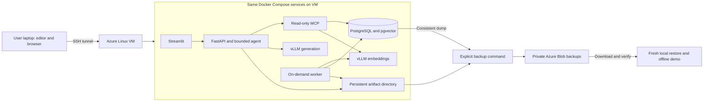

# Azure deployment and student services

Decision date: **13 November 2026**. Azure is now part of the project plan. This document separates the November thesis build from operation until **13 November 2027**. It records a design, not deployed infrastructure or permission to spend credit. The user applies infrastructure steps through the same explained, tested module workflow.

## Verified access and unresolved inputs

Read-only inspection of the user's Brave Azure Education overview on 13 November showed **$100 of $100 available**, **$0.00 November cost**, and expiry **13 November 2027**. Account identifiers and credentials are deliberately absent from these documents. The overview was inspected; VM quotas, available SKUs, region prices, spending-protection settings and GitHub Education activation were not.

Azure's offer is $100 for a 12-month period, not $100 per month. It allows one student subscription per eligible customer and generally cannot be combined with another offer. The GitHub Pack's Azure listing must not be counted as an additional $100. Credit exhaustion disables the subscription unless it is separately upgraded. Do not assume renewal after graduation. [Student offer terms](https://azure.microsoft.com/en-us/pricing/offers/ms-azr-0170p/), [Education FAQ](https://learn.microsoft.com/en-us/azure/education-hub/faq).

The user confirmed: **finish project and report by 30 November 2026; rehearse in December**. Defense is approximately the second week of December; its exact date and formal submission rules remain unconfirmed. Azure's longer availability does not postpone thesis delivery.

## Selected deployment

Use **one Linux Azure VM running the existing Docker Compose stack**, plus **private Azure Blob Storage for versioned backups and release bundles**. Keep a complete local development/restore path. These are planned deliverables, not optional decorations. Resource eligibility and the measured cost/latency gate must pass before committing to a VM configuration; a blocked Azure gate needs an explicit Architecture decision, not a fictitious completion.

“Local LLM” means **self-hosted inference within our Docker deployment**: it can run on the laptop or an Azure VM. It does not mean Azure-hosted data stays on the physical laptop. Azure stores the uploaded artifacts and hosts VM computations. As of 15 November, chat and embeddings use separate vLLM services on this one VM. Both read pinned model snapshots; their internal HTTP APIs remain reachable when inference containers have external egress disabled. The same two services must also start from cache on the local defense host.

| Component | Selected arrangement and reason |
|---|---|
| Compute | One on-demand x86-64 Linux VM; same application source/release, Compose contracts and model digests as the local deployment; pin platform-specific images if laptop architecture differs |
| Capacity | First price/eligibility check: 16 GiB RAM class; compare an eligible 2-vCPU memory-oriented option with 4-vCPU capacity. Price candidates before making a choice; 16 GiB is not a validated fit for both vLLM processes, the generation KV cache and the rest of Compose. Measure guest CPU flags, supported dtype, combined peak memory and end-to-end latency. Operate within the existing credit ceilings. Use 64–128 GiB total persistent disk only if measured cache/artifact needs justify it |
| Database and vectors | PostgreSQL/pgvector container on persistent managed disk; same migrations and queries, no managed database migration |
| Runtime artifacts | Same local-directory adapter on the selected host; durable managed disk, never temporary VM storage |
| Cloud archive | Standard general-purpose Blob account, Hot LRS initially, anonymous access disabled; compact versioned backup bundles, not a second live database |
| UI | Existing Streamlit history/performance/AI panels, accessed through SSH port forwarding to localhost bindings; no public application endpoint in this scope |
| Source and checks | GitHub repository and lightweight Actions CI; local task and module test gates remain authoritative |

Do not assume a free-tier VM can fit this stack. Benchmark one active question at a time and avoid concurrent training/generation. GPU is not part of the budget assumption: regional and VM-family quota, SKU eligibility and physical availability must all be checked. Azure ML GPU quotas commonly start at zero; a student offer does not establish access. If CPU performance fails, test a smaller self-hosted model on development questions or verified available hardware before research freeze. Do not upgrade subscriptions to obtain a GPU automatically. [VM quotas](https://learn.microsoft.com/en-us/azure/virtual-machines/quotas), [ML quotas](https://learn.microsoft.com/en-us/azure/machine-learning/how-to-manage-quotas?view=azureml-api-2), [example memory-oriented VM sizes](https://learn.microsoft.com/en-us/azure/virtual-machines/sizes/memory-optimized/easv5-series).

The logical data flow, SQL evidence, five MCP tools, RAG, verifier, UI and B1/B2/P experiments remain unchanged. Azure hosting is an engineering delivery contribution; it is not itself evidence of improved LLM accuracy. No general agent platform is needed.

M1 records both host CPU architectures. An ARM laptop and x86 VM may use different container image digests: keep source revision/configuration and model weights fixed, record each platform's tested dependency profile and image digest, and cache/test the correct images for each host. For multi-platform images record the index digest plus resolved platform digest. Do not force emulation merely to claim one identical image. All final B1/B2/P experiments use one host profile and the same frozen image/model digests; cross-host restore checks are reported separately.

## Storage, access and recovery contract

Keep application artifact URIs relative to the storage root. Blob is an **explicit backup/restore adapter**, not a replacement for filesystem atomic rename or a dependency of every question. Use `azure-storage-blob` and `azure-identity` only for the backup workflow. Pin them with the tested application dependencies. Use developer Entra authentication locally and the VM's managed identity for the backup process; scope Blob data access to the project container. Do not commit keys, tokens, connection strings or database passwords. [Python Blob SDK](https://learn.microsoft.com/en-us/azure/storage/blobs/storage-blob-upload-python).

Use one project resource group, a recorded region and owner/project/expiry tags. Restrict SSH to the user's current IP, use SSH keys, and expose no PostgreSQL, vLLM generation/embedding, MCP, API or Streamlit port publicly. Application services retain their existing database roles; the LLM has no Azure provisioning/upload tool. Restrict storage access to necessary clients, require HTTPS and disallow anonymous reads. Entra roles and storage/network settings must be tested rather than inferred from the resource existing. [Blob security guidance](https://learn.microsoft.com/en-us/azure/storage/blobs/security-recommendations).

Backup sequence: pause application/worker writes, produce a consistent PostgreSQL dump, collect the artifacts referenced by that dump plus config/lock/model manifests, compute a manifest of SHA-256 hashes, upload into a new immutable-by-convention backup prefix, and write a completion marker only after verification. Resume writers afterward. An interrupted prefix has no completion marker and cannot be selected for restore. Do not overwrite completed backups; enforce create-only uploads and reject a changed digest at an existing key. This is application immutability, not a claim that Azure WORM retention is configured.

Restore into an empty environment, verify every downloaded hash, restore the database and referenced files, then reopen a saved run/answer and compare counts, metrics and evidence hashes. Test interruption and denied/anonymous access. Keep a verified local copy independently of the subscription. LRS alone is not protection from accidental deletion or account expiry. Check generator, embedding and pretrained detector model terms/private-hosting rights in **M1 before downloading or copying weights**, including any required user acceptance. Check dataset terms/private-copy rights in **M2 before acquisition/cloud upload**, and review redistribution rights before publication. A model manifest is enough for routinely downloadable weights, but cache exact weights and each host's correct images for the offline defense. [Storage redundancy](https://learn.microsoft.com/en-us/azure/storage/common/storage-redundancy).

## Twelve-month credit plan

These are **proposed allocation ceilings**, not vendor quotes, a spend authorization or an enforced cap. Recalculate from actual regional prices before any resource creation. Keep the student subscription's spending protection; no automatic paid upgrade, Marketplace purchase or support plan is included.

| Allocation over the entire credit period | Planning ceiling |
|---|---:|
| Thesis build and December rehearsal: VM compute, disks, IP and transfers | $55 |
| Blob retention, transactions and downloads through November 2027 | $15 |
| Post-thesis short restart/demo sessions including temporary disks/network | $15 |
| Unallocated reserve | $15 |
| **Total, not a monthly allowance** | **$100** |

Before provisioning, record region, currency, SKU, operating-system price, disk tier/capacity, IP/network and storage/egress prices with date and source. Use the [Azure pricing calculator](https://azure.microsoft.com/en-us/pricing/calculator/). Compute allowable hours as `(phase allowance - disk/IP/storage/transfer estimate - phase contingency) / hourly VM price`. If the result cannot cover measured jobs, change the configuration or execution split before starting. No VM-hour count is promised here.

Create actual/forecast alerts where available, inspect remaining credit during active cloud work, and maintain a cumulative ledger across months. A monthly budget resets and is not the same as a year-long credit allowance. **Azure budgets notify; they do not stop consumption**, and usage reporting is delayed. Check the actual subscription protection in M1. New subscriptions may need time before Cost Management is available; record a manual cost check until alerts can be verified. [Budget behavior](https://learn.microsoft.com/en-us/azure/cost-management-billing/costs/tutorial-acm-create-budgets), [spending protection and exceptions](https://learn.microsoft.com/en-us/azure/cost-management-billing/manage/spending-limit).

After each session, deallocate the VM and verify **Stopped (deallocated)**; shutting down inside Linux is insufficient. Disks and some network resources still cost money while compute is deallocated. Set and test auto-shutdown as a backstop, including its timezone and actual deallocation result. After the defense, verify the local and Blob restore, then the user removes unneeded VM/disks/IP resources through the documented cleanup steps. Retain only compact backups and rebuild instructions; do not pay for an idle VM disk all year by accident. [VM billing states](https://learn.microsoft.com/en-us/azure/virtual-machines/states-billing).

| Period | Operating policy |
|---|---|
| 13–30 November 2026 | Build and test through M1–M6; start compute only for measured work; complete report/project by November 30 |
| 1–7 December | Rehearse from frozen artifacts, verify local fallback and recording; no new research features |
| Approx. 8–14 December | Defense, exact date to confirm; use a short Azure session only when needed |
| After defense–October 2027 | Retain compact backups; manually review cost/credit monthly; recreate compute only for a specific demo or justified improvement; quarterly restore check |
| By 31 October 2027 | Export and verify all retained work outside Azure; plan shutdown/cleanup before November 13 expiry; do not assume renewal |

Later extensions require evidence: another dataset or stronger model after an observed failure, a managed database only if uptime/multi-user use warrants it, or a public authenticated UI only if sharing becomes a real requirement. These are future decisions, not additions to the 22 thesis tasks. No recurring automation has been created.

## GitHub Student Pack selection

The [Pack catalogue](https://education.github.com/pack) was checked on 13 November; the user's GitHub benefits and remaining allowances have **not** been verified. Graduation can affect eligibility. Record actual activation/expiry rather than assuming all offers last until Azure expiry. Keep reproduction possible on GitHub Free and local tools.

| Service | Decision |
|---|---|
| GitHub Pro | Use student benefits after activation is verified for repository/review controls. Private repositories also exist on Free; Pro is not a build prerequisite |
| GitHub Actions | Include lightweight lint/unit/schema/fixture checks in M1.T2 and extend with each module. No model training, large datasets, credentials or held-out evaluations on every push. Keep short artifact retention and block paid overages |
| Codespaces | Contingency development environment only if it resolves a demonstrated local setup problem; not the primary AI host or another required cloud |
| Copilot Student | Personal coding aid if activated and useful; does not replace Codex explanations, user implementation, test evidence or self-hosted research inference |
| Other Pack services | No additional host, database, monitoring subscription or domain is selected. Add one only for a concrete unmet requirement, not merely because a promotion exists |

Current official limits are account-dependent and must be checked again at activation: Pro lists **$18/month eligible Actions/cloud compute usage and 1 GB Actions storage**; Codespaces lists **180 core-hours and 20 GB-month**. Core-hours are not wall-clock hours, and stopped Codespaces retain billable storage. These are separate GitHub allowances, not Azure credit. Copilot's current student product is **Copilot Student**; do not assume Copilot Pro or a fixed premium-request quota. [Included usage](https://docs.github.com/en/billing/reference/product-usage-included), [Codespaces billing](https://docs.github.com/en/billing/concepts/product-billing/github-codespaces), [Copilot plans](https://docs.github.com/en/copilot/get-started/plans), [Pack terms](https://docs.github.com/en/education/about-github-education/github-education-for-students/github-terms-and-conditions-for-the-student-developer-pack).

CI supplements the user's task checks. A green workflow does not establish that local hardware, Azure access, manual UI checks or research experiments passed. Do not create a remote, push code, activate partner accounts or deploy from this planning session.

## Existing-module integration and evidence

| Task | Added work and gate |
|---|---|
| M1.T1 | Record offer/expiry, region/quotas/SKU price candidates, local/VM CPU architectures, year-long cost allocation, GitHub activation state and actual deadline. Check model terms before downloads/private hosting. No secrets in evidence |
| M1.T2 | Same Compose/storage contracts; private Blob backup adapter and synthetic-fixture round trip; minimal CI. Verify private/denied access, checksum preservation, interrupted-upload handling and CI results |
| M1.T3 | Manually provision the selected affordable VM after preflight and model-term checks; run both vLLM services together with the MCP fixture from [the M1.T3 gate](../plan/development-plan.md); record hardware/platform-specific image digests/model digests, five-question gate, SSH-only access and deallocation. Verify local cached-model/images smoke path too |
| M2.T4 | Back up a released, rights-reviewed dataset manifest and complete catalog; test resume and restore without double-counting. Record local versus Azure copies |
| M3.T1–T3 | Record training/inference host and cost, choose a measured device path before test; checkpoint and prediction backups. Azure GPU is not presumed |
| M4–M5 | Preserve SQL/RAG/MCP/UI behavior; pin one hardware profile for all final LLM conditions. Retain snapshot/corpus/model hashes when moving hosts |
| M6.T1 | Fresh local restore from Blob, full offline workflow, reopened history/evidence, cloud isolation and deallocation checks; document cost/backup/cleanup runbook |
| M6.T4 | Record final credit/resource ledger, December demo arrangements and post-defense retention/expiry handoff |

All additions inherit the mandatory task/module gates in [WORKFLOW](../agent/WORKFLOW.md). No resource has been created, cloud configuration tested, CI run or implementation task passed by publishing this plan.
