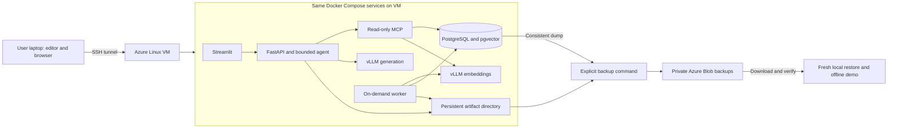

# Azure deployment and student services

On 25 November 2026 the owner confirmed Azure as the primary live inference environment with the existing vLLM models. Local development uses synthetic fixtures and mocked endpoints. Local offline model serving (M1.T3 V04) is deferred until after initial release. See the [acceptance record](../operations/m1t3-deployment-checklist.md#final-azure-benchmark--25-november-2026).

Azure was selected on 13 November 2026. On **17 November 2026** the owner deferred M1.T3 until the local core is ready for AI integration. The planned operating/retention horizon ends **13 November 2027**. The owner runs any later provisioning and verification through the guided task workflow.

## Verified access and unresolved inputs

The owner confirmed the following M1.T3 Stage 1 preflight findings on 17 November 2026. They supersede the expiry and pending quota/price entries in the original 13 November planning snapshot.

| Preflight item | Recorded finding |
|---|---|
| Azure for Students | **$100 remaining**, credit expires **12 November 2028** |
| Provider and approved region | `Microsoft.Compute` registered, `eastasia` |
| Regional and family quota | 6 regional vCPUs available, sufficient matching family quota for the candidate, no reported SKU restrictions |
| VM candidate and public compute price | `Standard_E4_v4`, 4 vCPUs, 32 GiB RAM, **$0.334/hour** |
| OS image | Ubuntu Server 24.04 LTS x64 Gen2 available |
| Proposed persistent disk and public retail price | 128 GiB Standard SSD LRS, **$9.60/month** |

No VM has been provisioned. Physical capacity at allocation, guest CPU/dtype compatibility, simultaneous model residency, latency and offline inference still require direct tests. The two prices are dated estimates. Existing private Blob resources and the completed M1.T2 recovery evidence remain in use. Spending-protection settings and GitHub Education activation still require verification before relying on them.

Budget against the single verified $100 balance. The GitHub Pack Azure listing adds no second allocation to this plan. Keep spending protection and plan independently of renewal after graduation. [Student offer terms](https://azure.microsoft.com/en-us/pricing/offers/ms-azr-0170p/), [Education FAQ](https://learn.microsoft.com/en-us/azure/education-hub/faq).

The user confirmed: **finish project and report by 30 November 2026; rehearse in December**. Defense is approximately the second week of December; its exact date and formal submission rules remain unconfirmed. Azure's longer availability does not postpone thesis delivery.

## Selected deployment

Use **one Linux Azure VM running the existing Docker Compose stack**, plus **private Azure Blob Storage for versioned backups and release bundles**. Keep a complete local development/restore path. Build the dataset, YOLO11n, database/backend, analytics, dashboard and interface contracts on the Mac first. Resume the existing M1.T3 before accepting live indexing/retrieval/MCP or starting M5. At that point recheck cost, access and quota before provisioning, then measure the actual VM and local fallback. A blocked runtime gate stays pending for an Architecture decision.

“Local LLM” means **self-hosted inference within our Docker deployment**: it can run on the laptop or an Azure VM. It does not mean Azure-hosted data stays on the physical laptop. Azure stores the uploaded artifacts and hosts VM computations. The deployment design uses separate vLLM generation and embedding services on the same VM. Both read pinned model snapshots; their internal HTTP APIs remain reachable when inference containers have external egress disabled. The same two services must also start from cache on the local defense host.

| Component | Selected arrangement and reason |
|---|---|
| Compute | One on-demand x86-64 Linux VM; same application source/release, Compose contracts and model digests as the local deployment; pin platform-specific images if laptop architecture differs |
| Capacity | Size against the Stage 1 candidate above. On resumption confirm capacity and price, size the persistent disk from cache/artifact needs, and measure guest CPU flags, supported dtype, combined peak memory and end-to-end latency with both vLLM processes and the rest of Compose |
| Database and vectors | PostgreSQL/pgvector container on persistent managed disk; same migrations and queries, no managed database migration |
| Runtime artifacts | Same local-directory adapter on the selected host; durable managed disk, never temporary VM storage |
| Cloud archive | Standard general-purpose Blob account, Hot LRS initially, anonymous access disabled; compact versioned backup bundles, not a second live database |
| UI | History/performance/AI panels through an SSH tunnel in the original research deployment profile. The React/upload and public-hosting question is tracked in [project state](../agent/PROJECT_STATE.md) |
| Source and checks | GitHub repository and lightweight Actions CI; local task and module test gates remain authoritative |

Do not assume a free-tier VM can fit this stack. Benchmark one active question at a time and avoid concurrent training/generation. GPU is not part of the budget assumption: regional and VM-family quota, SKU eligibility and physical availability must all be checked. Azure ML GPU quotas commonly start at zero; a student offer does not establish access. If CPU performance fails, record the failure and review existing fallback options with Architecture before research freeze. Any smaller-model development trial requires its own label and evidence. The approved Qwen3/EmbeddingGemma pair remains the target for M1.T3. Do not upgrade subscriptions to obtain a GPU automatically. [VM quotas](https://learn.microsoft.com/en-us/azure/virtual-machines/quotas), [ML quotas](https://learn.microsoft.com/en-us/azure/machine-learning/how-to-manage-quotas?view=azureml-api-2), [example memory-oriented VM sizes](https://learn.microsoft.com/en-us/azure/virtual-machines/sizes/memory-optimized/easv5-series).

The logical data flow, SQL evidence, five MCP tools, RAG, verifier, UI and B1/B2/P experiments remain unchanged. Azure hosting is an engineering delivery contribution; it is not itself evidence of improved LLM accuracy. No general agent platform is needed.

M1 records both host CPU architectures. An ARM laptop and x86 VM may use different container image digests: keep source revision/configuration and model weights fixed, record each platform's tested dependency profile and image digest, and cache/test the correct images for each host. For multi-platform images record the index digest plus resolved platform digest. Do not force emulation merely to claim one identical image. All final B1/B2/P experiments use one host profile and the same frozen image/model digests; cross-host restore checks are reported separately.

## Storage, access and recovery contract

Keep application artifact URIs relative to the storage root. Blob is an **explicit backup/restore adapter**, not a replacement for filesystem atomic rename or a dependency of every question. Use `azure-storage-blob` and `azure-identity` only for the backup workflow. Pin them with the tested application dependencies. Use developer Entra authentication locally and the VM's managed identity for the backup process; scope Blob data access to the project container. Do not commit keys, tokens, connection strings or database passwords. [Python Blob SDK](https://learn.microsoft.com/en-us/azure/storage/blobs/storage-blob-upload-python).

Use one project resource group, a recorded region and owner/project/expiry tags. Restrict SSH to the user's current IP, use SSH keys, and expose no PostgreSQL, vLLM generation/embedding, MCP, API or Streamlit port publicly. Application services retain their existing database roles; the LLM has no Azure provisioning/upload tool. Restrict storage access to necessary clients, require HTTPS and disallow anonymous reads. Entra roles and storage/network settings must be tested rather than inferred from the resource existing. [Blob security guidance](https://learn.microsoft.com/en-us/azure/storage/blobs/security-recommendations).

Backup sequence: pause application/worker writes, produce a consistent PostgreSQL dump, collect the artifacts referenced by that dump plus config/lock/model manifests, compute a manifest of SHA-256 hashes, upload into a new immutable-by-convention backup prefix, and write a completion marker only after verification. Resume writers afterward. An interrupted prefix has no completion marker and cannot be selected for restore. Do not overwrite completed backups; enforce create-only uploads and reject a changed digest at an existing key. This is application immutability, not a claim that Azure WORM retention is configured.

Restore into an empty environment, verify every downloaded hash, restore the database and referenced files, then reopen a saved run/answer and compare counts, metrics and evidence hashes. Test interruption and denied/anonymous access. Keep a verified local copy independently of the subscription. LRS alone is not protection from accidental deletion or account expiry. Use the M1.T1 source inventory for the detector and confirm its terms before weight acquisition or copying in the vision work. Resume generator/embedding access, terms and private-hosting checks in M1.T3 Stage 2 before downloading or copying either snapshot. Check dataset terms/private-copy rights in **M2 before acquisition/cloud upload**, and review redistribution rights before publication. A model manifest is enough for routinely downloadable weights, but cache exact weights and each host's correct images for the offline defense. [Storage redundancy](https://learn.microsoft.com/en-us/azure/storage/common/storage-redundancy).

## Owner-approved hybrid recovery — 26 November 2026

For VisionQ v1.0 restricted NEU-DET material, the owner replaced full cloud-catalog
backup with a two-source recovery contract. Existing private Blob stores only the
six-file 3615-byte recovery-control package pinned by
`9b85738ad6893f44c4cb642529357427863f847f7628d236c53870e2b08dedd9`.
An independent owner-controlled offline medium retains the complete catalog and
all dataset artifacts. Approval does not override third-party rights; no dataset
samples, boxes, XML, derived images, catalog contents or model weights are uploaded.

M2 acceptance and M6 fresh recovery must download and verify private control
metadata, reject anonymous access, verify the offline full backup against its
anchor, then restore into an empty local database and compare records and every
artifact hash. Missing/corrupt control metadata or offline artifacts fail closed.
Cloud alone is not disaster recovery for this dataset. Record the offline medium,
owner custody and retention responsibility, maintain both sources through the
operations horizon, and include this dependency in M6 limitations/rehearsal.
Previously verified M1 foundation backups remain unchanged. Hybrid recovery needs no VM. During acceptance the existing VM was found running; the owner explicitly instructed leaving it running and will handle power state. No agent VM state change occurred.

## Budget and twelve-month operating plan

These are **proposed allocation ceilings**, not vendor quotes, a spend authorization or an enforced cap. Recalculate from actual regional prices before any resource creation. Keep the student subscription's spending protection; no automatic paid upgrade, Marketplace purchase or support plan is included.

| Allocation against the verified balance | Planning allowance |
|---|---:|
| On-demand VM compute for thesis experiments and December rehearsal | ~$55 |
| Storage, including VM disk and Blob retention/transactions through November 2027 | $15 |
| Additional experiments or short post-thesis demo sessions, including network charges | $15 |
| Unallocated reserve | $15 |
| **Total, not a monthly allowance** | **$100** |

On resumption, refresh the Stage 1 prices and separately estimate disk, IP, storage/egress and experiment duration. Keep expected compute hours × hourly VM rate within the compute allocation and total expected charges within the remaining credit. Reforecast if the measured workloads exceed either allowance. [Azure pricing calculator](https://azure.microsoft.com/en-us/pricing/calculator/).

Create actual/forecast alerts where available, inspect remaining credit during active cloud work, and maintain a cumulative ledger across months. A monthly budget resets and is not the same as a year-long credit allowance. **Azure budgets notify; they do not stop consumption**, and usage reporting is delayed. Check the actual subscription protection in M1. New subscriptions may need time before Cost Management is available; record a manual cost check until alerts can be verified. [Budget behavior](https://learn.microsoft.com/en-us/azure/cost-management-billing/costs/tutorial-acm-create-budgets), [spending protection and exceptions](https://learn.microsoft.com/en-us/azure/cost-management-billing/manage/spending-limit).

After each session, deallocate the VM and verify **Stopped (deallocated)**; shutting down inside Linux is insufficient. Disks and some network resources still cost money while compute is deallocated. Set and test auto-shutdown as a backstop, including its timezone and actual deallocation result. After the defense, verify the local and Blob restore, then the user removes unneeded VM/disks/IP resources through the documented cleanup steps. Retain only compact backups and rebuild instructions; do not pay for an idle VM disk all year by accident. [VM billing states](https://learn.microsoft.com/en-us/azure/virtual-machines/states-billing).

| Period | Operating policy |
|---|---|
| 13–30 November 2026 | Complete the local core, then the deferred M1.T3 and live AI gates. Target project/report completion by November 30 and flag any shortfall |
| 1–7 December | Rehearse from frozen artifacts, verify local fallback and recording; no new research features |
| Approx. 8–14 December | Defense, exact date to confirm; use a short Azure session only when needed |
| After defense–October 2027 | Retain compact backups; manually review cost/credit monthly; recreate compute only for a specific demo or justified improvement; quarterly restore check |
| By 31 October 2027 | Export and verify all retained work outside Azure; plan shutdown/cleanup by the 13 November 2027 retention target. The verified credit expiry is 12 November 2028 |

Later extensions require evidence: another dataset or stronger model after an observed failure, a managed database only if uptime/multi-user use warrants it, or a public authenticated UI only if sharing becomes a real requirement. These are future decisions, not additions to the 22 thesis tasks. No recurring automation has been created.

## GitHub Student Pack selection

The [Pack catalogue](https://education.github.com/pack) was checked on 13 November; the user's GitHub benefits and remaining allowances have **not** been verified. Graduation can affect eligibility. Record actual activation/expiry rather than assuming all offers last until Azure expiry. Keep reproduction possible on GitHub Free and local tools.

| Service | Decision |
|---|---|
| GitHub Pro | Use student benefits after activation is verified for repository/review controls. Private repositories also exist on Free; Pro is not a build prerequisite |
| GitHub Actions | Include lightweight lint/unit/schema/fixture checks in M1.T2 and extend with each module. No model training, large datasets, credentials or held-out evaluations on every push. Keep short artifact retention and block paid overages |
| Codespaces | Contingency development environment only if it resolves a demonstrated local setup problem; not the primary AI host or another required cloud |
| Copilot Student | Personal coding aid if activated and useful; does not replace Codex explanations, user implementation, test evidence or self-hosted research inference |
| Other Pack services | No additional host, database, monitoring subscription or domain is selected. Add one only for a concrete unmet requirement, not merely because a promotion exists |

Current official limits are account-dependent and must be checked again at activation: Pro lists **$18/month eligible Actions/cloud compute usage and 1 GB Actions storage**; Codespaces lists **180 core-hours and 20 GB-month**. Core-hours are not wall-clock hours, and stopped Codespaces retain billable storage. These are separate GitHub allowances, not Azure credit. Copilot's current student product is **Copilot Student**; do not assume Copilot Pro or a fixed premium-request quota. [Included usage](https://docs.github.com/en/billing/reference/product-usage-included), [Codespaces billing](https://docs.github.com/en/billing/concepts/product-billing/github-codespaces), [Copilot plans](https://docs.github.com/en/copilot/get-started/plans), [Pack terms](https://docs.github.com/en/education/about-github-education/github-education-for-students/github-terms-and-conditions-for-the-student-developer-pack).

CI supplements the user's task checks. A green workflow does not establish that local hardware, Azure access, manual UI checks or research experiments passed. Do not create a remote, push code, activate partner accounts or deploy from this planning session.

## Existing-module integration and evidence

| Task | Added work and gate |
|---|---|
| M1.T1 | Completed under the owner-approved scope. Its historical V08 deferral and dated platform evidence are recorded in the [foundation record](../agent/M1_FOUNDATION.md). Use the Stage 1 snapshot above for current Azure preflight |
| M1.T2 | Completed, V01–V08. Preserve private Blob Storage resources, checksum/restore and interrupted-backup evidence, and the CI record in the [task log](../agent/TASK_LOG.md) |
| M1.T3 | Deferred after preflight. On resumption complete Stage 2 model access/terms, downloads, SHA-256 manifests and staging, then Stage 3 T3 dependencies, probe/metric code, tests, Compose overlay and CPU image preparation. Once cost and access are confirmed, manually provision the selected affordable VM and run both vLLM services together with the MCP fixture from [the M1.T3 gate](../plan/development-plan.md); record hardware/platform-specific image digests/model digests, five-question gate, SSH-only access and deallocation. Carry the local cached-model restart to post-release V04 recovery in M6.T1 |
| M2.T4 | Verify approved private Blob recovery-control metadata plus independent offline complete catalog/artifacts; test hybrid restore and resume without double-counting. Record both sources and retention |
| M3.T1–T3 | Record training/inference host and cost, choose a measured device path before test; checkpoint and prediction backups. Azure GPU is not presumed |
| M4–M5 | Develop SQL/backend and dashboard with local results and clearly labeled interface fixtures. After M4.T1 and M4.T4, pass M1.T3 and the M1 integration gate. Finish M4.T2, M4.T3 and M4 integration before M5. Pin one hardware profile for all final LLM conditions. Retain snapshot/corpus/model hashes when moving hosts |
| M6.T1 | Fresh hybrid local restore using Blob control metadata and independent offline artifacts, post-release V04 offline workflow, reopened history/evidence, cloud isolation and deallocation checks; document cost/backup/cleanup runbook |
| M6.T4 | Record final credit/resource ledger, December demo arrangements and post-defense retention/expiry handoff |

All additions inherit the mandatory task/module gates in [WORKFLOW](../agent/WORKFLOW.md). The Stage 1 record supports a future provisioning decision. Runtime and research claims require the actual task evidence.
